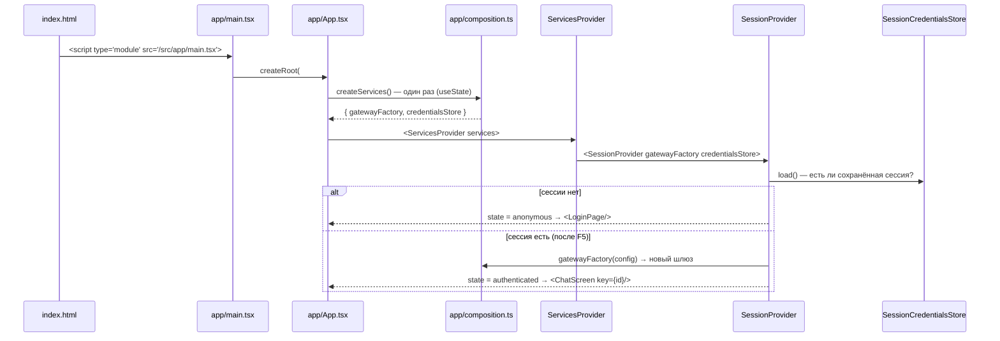
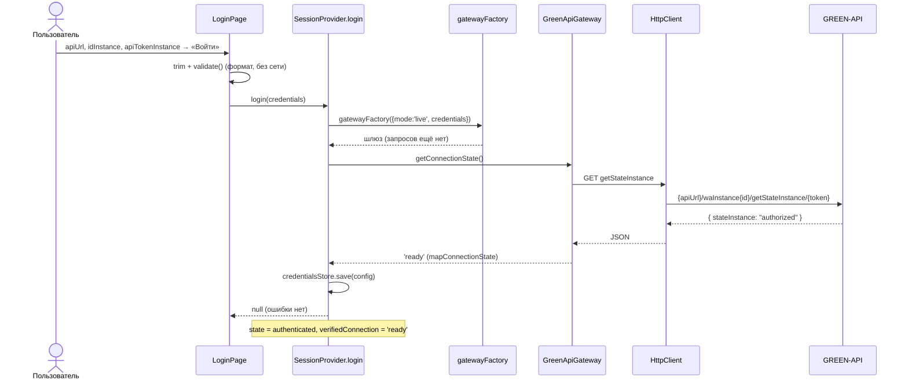
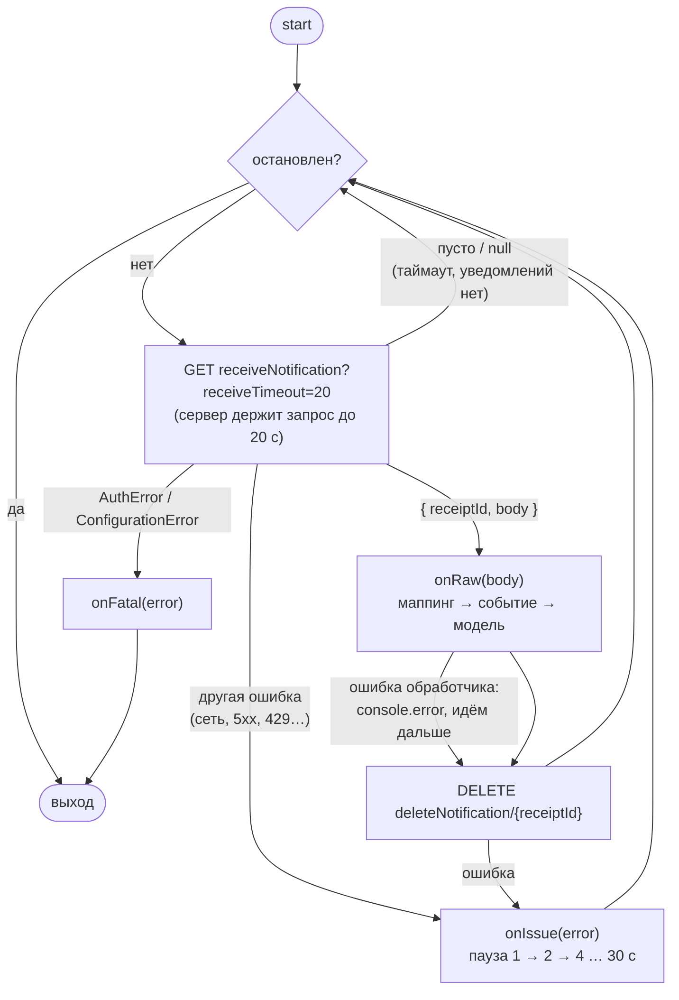
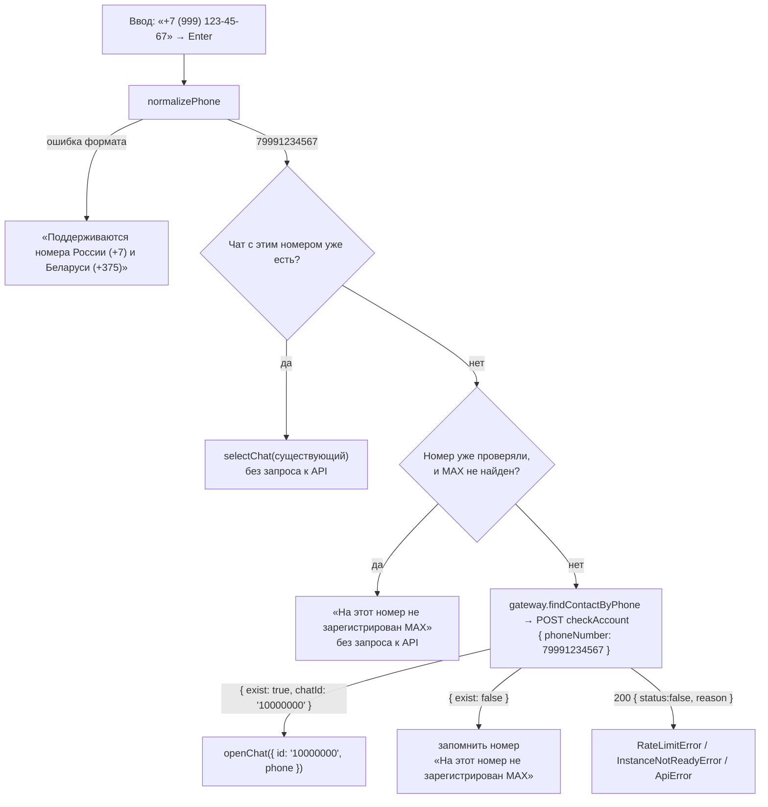
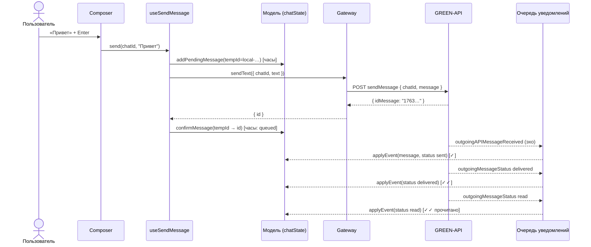

# Как работает MAX Web Chat

Документ описывает путь приложения от загрузки страницы до появления ответа в чате: какой код выполняется, в каком порядке и почему он устроен именно так. Как запустить проект, настроить GREEN-API и расширять код — в [README.md](README.md). Здесь — внутренняя логика.

## Содержание

1. [Карта модулей за одну минуту](#1-карта-модулей-за-одну-минуту)
2. [Запуск: от index.html до первого экрана](#2-запуск-от-indexhtml-до-первого-экрана)
3. [Вход](#3-вход)
4. [Экран чатов: что происходит при монтировании](#4-экран-чатов-что-происходит-при-монтировании)
5. [Получение сообщений: цикл long polling](#5-получение-сообщений-цикл-long-polling)
6. [От сырого уведомления к доменному событию](#6-от-сырого-уведомления-к-доменному-событию)
7. [Состояние чатов: чистые переходы](#7-состояние-чатов-чистые-переходы)
8. [Создание чата по номеру](#8-создание-чата-по-номеру)
9. [Отправка сообщения и жизненный цикл статуса](#9-отправка-сообщения-и-жизненный-цикл-статуса)
10. [Гонки и повторы: разбор по шагам](#10-гонки-и-повторы-разбор-по-шагам)
11. [HTTP-слой и ошибки](#11-http-слой-и-ошибки)
12. [Выход, перезагрузка, смена аккаунта](#12-выход-перезагрузка-смена-аккаунта)
13. [Демо-режим](#13-демо-режим)
14. [Отрисовка: как UI получает данные](#14-отрисовка-как-ui-получает-данные)
15. [Сквозной пример: «Привет» → ответ с телефона](#15-сквозной-пример-привет--ответ-с-телефона)
16. [Диагностика: сообщение «висит» на часах](#16-диагностика-сообщение-висит-на-часах)

---

## 1. Карта модулей за одну минуту

```
src/
  app/             запуск и сборка: какие реализации подключить, какой экран показать
  domain/          язык приложения: Chat, Message, события, порты (интерфейсы), ошибки
  infrastructure/  связь с внешним миром: HTTP, GREEN-API, мок, sessionStorage
  features/        сценарии: вход (auth) и переписка (chat: модель, хуки, экраны)
  shared/          утилиты без привязки к сценарию (номера телефонов)
  ui/              «глупые» компоненты: кнопка, поле, аватар, галочки
```

Главное правило — **зависимости направлены внутрь**:

```
app ──▶ features ──▶ domain ◀── infrastructure
             │                        ▲
             └──────── ui             │
app ──────────────────────────────────┘   (только composition.ts знает про реализации)
```

- `domain` ни от чего не зависит: ни от React, ни от GREEN-API.
- `features` знают только интерфейсы из `domain/ports.ts` и получают реализацию через React Context.
- `infrastructure` реализует эти интерфейсы.
- `app/composition.ts` — единственное место, где написано «используй GREEN-API» или «используй мок».

**Зачем так.** Чтобы любую часть можно было заменить, не трогая остальное. Другой мессенджер — это новая реализация `MessengerGateway`; вебхуки вместо опроса — новая `NotificationSource`; другой дизайн — правка `ui/` и `styles.css`. Модель чатов и хуки при этом не меняются.

---

## 2. Запуск: от index.html до первого экрана



По шагам:

1. **`main.tsx`** монтирует `<App/>` внутри `StrictMode`. StrictMode включён намеренно: в режиме разработки React дважды запускает эффекты (подписка → отписка → подписка). Это проверка того, что цикл опроса корректно останавливается и не плодит дубликаты (см. раздел 4).
2. **`App.tsx`** вызывает `createServices()` один раз — через `useState(createServices)`, а не в теле компонента, иначе сервисы пересоздавались бы при каждом рендере.
3. **`composition.ts`** возвращает два объекта:
   - `gatewayFactory(config)` — по конфигурации сессии создаёт `MockGateway` (демо) или `GreenApiGateway` (боевой режим);
   - `credentialsStore` — `SessionCredentialsStore` поверх `sessionStorage`.
4. **`ServicesProvider`** кладёт сервисы в контекст и передаёт их в `SessionProvider` **пропсами**. Поэтому `features/` не импортируют ничего из `app/`, и направление зависимостей сохраняется.
5. **`SessionProvider`** при первом рендере (ленивый `useState`) читает `credentialsStore.load()`:
   - ничего нет → состояние `anonymous` → `App` рисует `LoginPage`;
   - есть конфигурация → сразу создаётся шлюз и состояние `authenticated` → `App` рисует `ChatScreen`.

**Почему при восстановлении после F5 не проверяется GetStateInstance.** Это лишний запрос с лимитом 1 в секунду, и он задержал бы появление экрана. Если токен успел стать недействительным, первый же запрос опроса вернёт 401 → `AuthError` → сессия закроется с понятной причиной (раздел 12).

**Почему `ChatScreen` получает `key={state.id}`.** У каждой сессии свой порядковый номер. Новый `key` заставляет React полностью пересоздать экран: новое хранилище чатов, новая подписка, пустые черновики. Переписка одного инстанса не может «протечь» в сессию другого.

---

## 3. Вход

Файлы: [LoginPage.tsx](src/features/auth/LoginPage.tsx), [SessionProvider.tsx](src/features/auth/SessionProvider.tsx).



### Шаги

1. **Проверка формата в `LoginPage.validate`**: `apiUrl` начинается с `http(s)://`, `idInstance` — только цифры, токен не пустой. Это делается до запроса, чтобы не тратить лимит GetStateInstance (1 запрос в секунду) на очевидные опечатки.
2. **`login()`** создаёт шлюз через фабрику и вызывает `getConnectionState()`. Шлюз переводит ответ GREEN-API в доменное состояние:

   | `stateInstance` (GREEN-API) | `ConnectionState` (домен) | Результат входа |
   |---|---|---|
   | `authorized` | `ready` | вход |
   | `suspended` | `restricted` | вход + предупреждение в сайдбаре |
   | `notAuthorized`, `pendingPassword` | `notAuthorized` | ошибка «отсканируйте QR-код» |
   | `starting` | `starting` | ошибка «подождите пару минут» |
   | `blocked` | `blocked` | ошибка «аккаунт заблокирован» |
   | что-то новое | `unknown` | ошибка «неизвестное состояние» |

3. **Ошибки сети и HTTP** приходят уже доменными (`AuthError`, `NetworkError`…, раздел 11). `login` превращает их в текст через `errorMessage()` и возвращает строку. Форма показывает её в `Alert`.
4. **Успех**: конфигурация сохраняется в `sessionStorage`, состояние становится `authenticated`. Вместе с ним запоминается `verifiedConnection` — состояние, которое только что проверили. Экран чатов использует его и не делает второй GetStateInstance подряд.
5. **Демо-режим** (`startDemo`) — та же ветка без проверки: конфигурация `{ mode: 'demo' }`, фабрика вернёт `MockGateway`.

**Почему `login` возвращает строку, а не бросает исключение.** Для формы ошибка входа — обычный результат, а не исключительная ситуация. Так `LoginPage` не нужен try/catch, а состояние «загрузка» сбрасывается только при ошибке: при успехе компонент уже размонтирован.

---

## 4. Экран чатов: что происходит при монтировании

Файл: [ChatScreen.tsx](src/features/chat/ui/ChatScreen.tsx), хук [useMessengerSync.ts](src/features/chat/hooks/useMessengerSync.ts).

```
ChatScreen
 ├─ useState(() => createChatStore())   ← своё хранилище на сессию
 └─ <ChatStoreContext.Provider>
     └─ ChatLayout
         ├─ useMessengerSync()           ← запуск получения событий
         ├─ NavigationRail               ← «Чаты», «Выйти», аватар инстанса
         ├─ aside.sidebar
         │   ├─ SidebarHeader
         │   ├─ ConnectionBanner         ← предупреждения о подключении
         │   ├─ NewChatForm              ← номер → чат
         │   └─ ChatList
         └─ main.pane
             └─ ChatWindow key=chatId    ← шапка, MessageList, Composer
```

`useMessengerSync` в эффекте делает две вещи.

1. **Узнаёт состояние подключения.** Если сессия только что открыта через `login`, берётся `verifiedConnection` без запроса. После F5 или нажатия «Повторить» вызывается `gateway.getConnectionState()`. Результат попадает в хранилище (`actions.setConnection`), и `ConnectionBanner` показывает предупреждение, если аккаунт не готов.
2. **Подписывается на события**: `gateway.subscribe({ onEvent, onIssue, onFatal })`.
   - `onEvent` → `actions.applyEvent` — событие уходит в чистую функцию модели (раздел 7);
   - `onIssue(error)` → временная проблема («Нет связи… Переподключаемся…»), `onIssue(null)` — проблема ушла;
   - `onFatal(error)`: `AuthError` → `logout(причина)`; любая другая (например, задан `webhookUrl`) → красная плашка с кнопкой «Повторить».

Функция очистки эффекта отменяет запрос состояния (`AbortController`) и отписывается.

### Почему двойной mount в StrictMode не создаёт два цикла

```
mount #1:   subscribe(h1)  → источник запущен (цикл A, висит long poll)
unmount #1: unsubscribe(h1) → подписчиков 0 → stop() → AbortController.abort()
                              → висящий fetch цикла A оборван, цикл A вышел
mount #2:   subscribe(h2)  → источник запущен заново (цикл B)
```

Это обеспечивают два механизма:

- **`createSharedSubscription`** ([sharedSubscription.ts](src/infrastructure/common/sharedSubscription.ts)) — у шлюза один источник событий на всех подписчиков. Он запускается при первой подписке и останавливается после последней отписки. Это важно не только для StrictMode: у инстанса GREEN-API **одна** очередь уведомлений, и два параллельных цикла делили бы её между собой — каждый видел бы только часть событий.
- **`AbortController` в `HttpPollingSource.start`** — остановка обрывает даже запрос, висящий в ожидании (long poll). Без этого «старый» цикл дождался бы ответа, обработал бы уведомление и удалил его из очереди, хотя его подписчик уже ушёл.

---

## 5. Получение сообщений: цикл long polling

Файл: [HttpPollingSource.ts](src/infrastructure/greenapi/HttpPollingSource.ts).



### Почему последовательный цикл, а не `setInterval`

ReceiveNotification — это **long polling**: запрос висит до `receiveTimeout` секунд, пока в очереди не появится уведомление, и возвращает его сразу, как только оно появилось. Поэтому новый запрос нужен ровно после завершения предыдущего:

- `setInterval` раз в N секунд добавлял бы задержку до N секунд и, хуже того, запускал бы **параллельные** запросы к одной FIFO-очереди. Тогда одно уведомление могли бы получить два запроса, а порядок обработки бы нарушился;
- последовательный `while` даёт минимальную задержку (уведомление обрабатывается в момент появления) и строгий порядок.

### Почему 20 секунд

Документация разрешает от 5 до 60 секунд. Чем дольше, тем меньше пустых запросов. Но слишком долгие запросы чаще обрывают прокси и мобильные сети. 20 секунд — компромисс. Таймаут самого HTTP-запроса — 20 + 10 секунд: запрос должен завершиться по таймауту сервера, а не быть оборванным клиентом.

### Почему уведомление удаляется даже при ошибке обработчика

Очередь FIFO: пока первое уведомление не удалено, ReceiveNotification будет возвращать его снова и снова. Если оно «ломает» обработчик (баг клиента, неожиданный формат), неудаление навсегда заблокировало бы все следующие сообщения. Поэтому ошибка обработчика логируется, а уведомление всё равно подтверждается.

### Что если упал сам DeleteNotification

Тогда следующий ReceiveNotification вернёт **то же самое** уведомление, и оно обработается второй раз. Это безопасно: модель применяет события идемпотентно — upsert по id (раздел 7). Ответ `{ result: false }` («уже удалено») тоже считается успехом.

### Ошибки и повторы

| Ошибка | Что делает цикл | Почему |
|---|---|---|
| `AuthError` (401, 403, истёкший инстанс) | останавливается, `onFatal` → выход из сессии | повторы с неверным токеном бессмысленны |
| `ConfigurationError` (задан `webhookUrl`) | останавливается, `onFatal` → плашка «Повторить» | пока webhookUrl не очищен, HTTP API не отдаст ни одного уведомления |
| сеть, таймаут, 5xx, 429, «инстанс запускается» | `onIssue`, пауза, повтор | временные проблемы |

Пауза растёт экспоненциально: `min(1000 · 2^(n−1), 30000)` мс, то есть 1, 2, 4, 8, 16, 30, 30… секунд. Так приложение не забрасывает сервер запросами при обрыве сети, но быстро восстанавливается после короткого сбоя. После первого успешного запроса счётчик сбрасывается и вызывается `onIssue(null)` — плашка «Переподключаемся…» исчезает.

---

## 6. От сырого уведомления к доменному событию

Файлы: [schemas.ts](src/infrastructure/greenapi/schemas.ts), [mappers.ts](src/infrastructure/greenapi/mappers.ts), [GreenApiGateway.ts](src/infrastructure/greenapi/GreenApiGateway.ts).

```
HttpPollingSource ──raw body──▶ GreenApiGateway.onRaw
                                     │
                                     ▼
                             mapNotification(raw)
                                     │  zod: typeWebhook?
         ┌──────────────┬────────────┼────────────────┬────────────────┐
         ▼              ▼            ▼                ▼                ▼
 incomingMessage  outgoingAPI…/  outgoingMessage  stateInstance   всё остальное
   Received       outgoingMessage    Status         Changed       (quotaExceeded…)
         │          Received          │                │                │
         ▼              ▼             ▼                ▼                ▼
  {type:'message'} {type:'message', {type:'status'} {type:'connection'}  null
   direction:in     direction:out,                                 (подтвердится
                    status:'sent'}                                  и забудется)
                                     │
                                     ▼
                      broadcast.onEvent(event) → все подписчики
```

### Что делает маппер

- **Проверка формы через zod.** Сначала читается только `typeWebhook`, затем — схема конкретного типа. Если данные не прошли схему, результат `null`, а не исключение. Битое уведомление не должно останавливать очередь (см. раздел 5).
- **Перевод имён.** `idMessage` → `id`, `senderData.chatId` → `chatId` (branded `ChatId`), `timestamp` в секундах → миллисекунды. Это единственное место в проекте, где встречаются имена полей GREEN-API.
- **Содержимое сообщения:**
  - `textMessageData.textMessage` или `extendedTextMessageData.text` → `{ kind: 'text', text }`;
  - `imageMessage`, `stickerMessage` и т.д. → `{ kind: 'unsupported', contentKind: 'image' | 'sticker' | … }` — UI покажет заглушку «Стикер — этот тип сообщений пока не поддерживается».
- **Сведения о чате (`ChatInfo`)** берутся **только из входящих**: `chatName` → `title`, `senderPhoneNumber` → `phone`. В эхе исходящих `senderData` описывает нас самих, и имя чата превратилось бы в наше собственное.
- **Группы** (chatId начинается с `-`): у сообщения заполняется `senderName`, номер телефона не берётся (для групп он равен 0).
- **Статусы:**

  | `status` (GREEN-API) | `MessageStatus` | Текст ошибки |
  |---|---|---|
  | `delivered` | `delivered` | — |
  | `read` | `read` | — |
  | `failed` | `failed` | «Не удалось отправить сообщение: {description}» |
  | `noAccount` | `failed` | «На этом номере не зарегистрирован MAX» |
  | `notInGroup` | `failed` | «Вы не участник этой группы» |
  | неизвестный | `null` | — |

- **Эхо** `outgoingAPIMessageReceived` (наше сообщение, отправленное через API) и `outgoingMessageReceived` (отправленное с телефона) превращаются в исходящее сообщение со статусом `sent`. Эхо — это подтверждение, что сообщение ушло с аккаунта.

**Почему доменные имена, а не имена API.** Если GREEN-API переименует поле или придётся подключить другого провайдера, правятся только `schemas.ts` и `mappers.ts`. Модель, хуки и компоненты продолжают работать с `Message.id` и `content.text`.

---

## 7. Состояние чатов: чистые переходы

Файлы: [chatState.ts](src/features/chat/model/chatState.ts) (логика), [chatStore.ts](src/features/chat/model/chatStore.ts) (обёртка zustand).

### Форма состояния

```ts
ChatState {
  chats:          Record<ChatId, Chat>        // id, title?, phone?, lastActivity, unreadCount
  messages:       Record<ChatId, Message[]>   // отсортированы по времени
  orphanStatuses: Record<messageId, {status, error?}>  // статусы «из будущего»
  activeChatId:   ChatId | null
  connection:     ConnectionState
  syncIssue:      { message, fatal } | null
}
```

### Почему чистые функции

Каждая функция в `chatState.ts` принимает состояние и возвращает новое: никакой сети, React или времени «изнутри» (время передаётся параметром). Поэтому самые хитрые места — гонки, повторы, слияние статусов — проверяются обычными unit-тестами за миллисекунды. `chatStore.ts` только связывает их с zustand:

```ts
applyEvent: (event) => set((s) => applyEvent(s, event))
```

### Основные переходы

| Функция | Когда вызывается | Что делает |
|---|---|---|
| `applyEvent(message)` | пришло сообщение | создаёт или дополняет чат, делает **upsert** сообщения по id, двигает `lastActivity`, увеличивает `unreadCount`, если чат не открыт |
| `applyEvent(status)` | пришёл статус | находит сообщение и **сливает** статус; если сообщения ещё нет — кладёт статус в `orphanStatuses` |
| `applyEvent(connection)` | `stateInstanceChanged` | обновляет `connection` |
| `openChat(info)` | создан чат по номеру | создаёт чат (если его нет) и делает активным |
| `selectChat(id)` | клик по чату | делает чат активным, обнуляет непрочитанные |
| `addPendingMessage` | пользователь нажал «Отправить» | добавляет сообщение с временным id и статусом `pending` |
| `confirmMessage` | SendMessage вернул `idMessage` | заменяет временный id настоящим, статус → `queued` |
| `failMessage` | SendMessage упал | статус → `failed` с текстом причины |

### Ключевые правила

**1. Upsert по id.** Сообщение никогда не добавляется «вслепую». Если сообщение с таким id уже есть, сохраняются его текст и время, а сливается только статус. Так повторная доставка уведомления (не прошёл DeleteNotification) и эхо нашего же сообщения не создают дублей. Если ничего не изменилось, функция возвращает **тот же объект** состояния, и React не перерисовывает экран.

**2. Статус только растёт.**

```
pending(0) → queued(1) → sent(2) → delivered(3) → read(4)
                       ↘ failed — финальный
```

`mergeStatus(текущий, новый)` берёт больший по рангу. Уведомления приходят разными каналами и не обязательно по порядку: `read` может прийти раньше `delivered`, а эхо (`sent`) — после `read`. Откат «прочитано» → «отправлено» выглядел бы как баг. Два исключения:

- `failed` финален — после него ничего не применяется;
- поздний `failed` не перекрывает `delivered`/`read`: если доставка подтверждена, ошибка противоречит факту.

**3. Осиротевшие статусы.** Статус приходит через очередь уведомлений, а `idMessage` — в ответе на HTTP-запрос SendMessage. Это разные каналы, поэтому `delivered` может прийти раньше, чем мы узнали id сообщения. Такой статус сохраняется в `orphanStatuses[id]` и применяется в момент, когда сообщение с этим id появится (при `confirmMessage` или при эхе). Чтобы статусы сообщений, отправленных не из этого окна, не копились бесконечно, хранится не больше 500 штук.

**4. Чат не теряет сведения.** `upsertChat` дополняет чат, но никогда не затирает известное имя или номер пустым значением. Чат, созданный по номеру, получает имя из первого входящего (`chatName`), а номер остаётся.

**5. Сортировка.** Сообщения вставляются по времени (`insertSorted`), даже если уведомления пришли не по порядку. Список чатов сортируется по `lastActivity` в `selectChatList`.

---

## 8. Создание чата по номеру

Файлы: [NewChatForm.tsx](src/features/chat/ui/NewChatForm.tsx), [useStartChat.ts](src/features/chat/hooks/useStartChat.ts), [phone.ts](src/shared/phone.ts).



### Нормализация номера

`normalizePhone` убирает всё, кроме цифр, и приводит привычные записи к международному формату:

| Ввод | Результат | Правило |
|---|---|---|
| `+7 (999) 123-45-67` | `79991234567` | только цифры |
| `8 999 123 45 67` | `79991234567` | российская 8 → 7 |
| `9991234567` | `79991234567` | 10 цифр с 9 → добавить 7 |
| `+375 29 123-45-67` | `375291234567` | только цифры |
| `80 29 123-45-67` | `375291234567` | белорусская 80 → 375 (проверяется раньше российской 8: российские коды не начинаются с 0) |

Принимаются только РФ (`7` + 10 цифр) и РБ (`375` + 9 цифр): CheckAccount работает только с ними.

### Почему CheckAccount, а не `номер@c.us`

В MAX chatId личного чата — **не номер телефона**, а отдельное число (`"10000000"`). Отправить можно и по `79991234567@c.us`, но тогда ответы и статусы придут с настоящим chatId. Приложение создало бы чат `79991234567@c.us`, а ответ пришёл бы в `10000000` — в другой, новый чат. Поэтому номер сначала превращается в chatId, и весь обмен идёт по нему. Шаг 5 сценария («вижу ответ в этом чате») работает именно поэтому.

### Почему так бережно с запросами

MAX расценивает частые проверки номеров — особенно повторные проверки несуществующих — как подозрительные и может временно ограничить аккаунт (HTTP 469). Поэтому:

- проверка запускается только по Enter или кнопке, а не на каждое нажатие клавиши;
- если чат с этим номером уже есть, он просто открывается;
- номера без MAX запоминаются (`useRef<Set>`) и повторно не проверяются;
- повторное нажатие во время запроса игнорируется (`inFlight`).

---

## 9. Отправка сообщения и жизненный цикл статуса

Файлы: [Composer.tsx](src/features/chat/ui/Composer.tsx), [useSendMessage.ts](src/features/chat/hooks/useSendMessage.ts).



### Поле ввода

- **Enter** отправляет, **Shift+Enter** — перенос строки. Во время набора через IME (японская раскладка, автозамена на телефоне) Enter подтверждает ввод, а не отправляет: проверяются `isComposing` и `keyCode === 229` (так сообщает Safari).
- Высота растёт по содержимому до 180px, дальше появляется прокрутка.
- Лимит длины приходит из `gateway.capabilities.maxTextLength` (4000 у GREEN-API) — UI его не хардкодит. С 90% лимита появляется счётчик, при превышении кнопка блокируется.
- Автофокус при открытии чата — только на устройствах с мышью (`pointer: fine`), чтобы на телефоне не выскакивала клавиатура.

### Оптимистичная отправка

Сообщение появляется в ленте **сразу**, до ответа сервера, со статусом `pending` и временным id `local-…`. Пользователь не ждёт сеть. Временный id строится из времени и счётчика, а не через `crypto.randomUUID`, который недоступен вне secure context (например, при открытии по `http://192.168…`).

### Статусы и их вид

| Статус | Откуда | Значок |
|---|---|---|
| `pending` | создан локально | часы |
| `queued` | SendMessage вернул `idMessage` — сообщение в очереди GREEN-API, но ещё не отправлено | часы |
| `sent` | эхо `outgoingAPIMessageReceived` | ✓ |
| `delivered` | `outgoingMessageStatus: delivered` | ✓✓ |
| `read` | `outgoingMessageStatus: read` | ✓✓ (цвет статуса) |
| `failed` | ошибка запроса или `failed` / `noAccount` / `notInGroup` | красный значок + текст под пузырём |

**Почему ответ 200 от SendMessage — это ещё не «отправлено».** По документации сообщение лишь ставится в очередь. Если отправка не удастся (например, в сервисный чат), GREEN-API всё равно вернёт 200 и `idMessage`, а позже пришлёт `outgoingMessageStatus: failed`. Поэтому после ответа статус `queued`, а не `sent`.

---

## 10. Гонки и повторы: разбор по шагам

### Эхо пришло раньше ответа SendMessage

```
t0  addPending        messages: [ tmp-1 (pending) ]
t1  эхо id=A          messages: [ tmp-1 (pending), A (sent) ]   ← на мгновение два пузыря
t2  confirm(tmp-1→A)  A уже есть → tmp-1 удаляется, A остаётся (sent)
    итог:             messages: [ A (sent) ]
```

### Статус пришёл раньше, чем стал известен id

```
t0  addPending              messages: [ tmp-1 (pending) ]
t1  status A=delivered      сообщения A нет → orphanStatuses: { A: delivered }
t2  confirm(tmp-1→A)        tmp-1 → A (queued), затем применяется orphan → delivered
    итог:                   messages: [ A (delivered) ], orphanStatuses: {}
```

### Уведомление пришло дважды

```
t0  входящее id=X        messages: [ X ], unreadCount: 1
t1  DeleteNotification упал → очередь снова отдаёт X
t2  входящее id=X        X уже есть → состояние не меняется (тот же объект)
    итог:                messages: [ X ], unreadCount: 1
```

### Статусы не по порядку

```
read → delivered → эхо(sent)   ⇒ остаётся read
failed → delivered             ⇒ остаётся failed
read → failed                  ⇒ остаётся read (доставка уже подтверждена)
```

Все эти сценарии покрыты тестами в [chatState.test.ts](src/features/chat/model/chatState.test.ts).

---

## 11. HTTP-слой и ошибки

Файлы: [HttpClient.ts](src/infrastructure/http/HttpClient.ts), [errors.ts](src/domain/errors.ts).

### Что делает HttpClient

1. **Собирает URL:** `{apiUrl без завершающих /}/waInstance{idInstance}/{method}/{apiTokenInstance}[/{suffix}][?query]`. Сегменты кодируются через `encodeURIComponent`. `apiUrl` у каждого инстанса свой, поэтому он не хардкодится.
2. **Держит токен.** Токен подставляется **только здесь**. Шлюз, хуки и компоненты его не видят и не могут случайно залогировать. Тексты ошибок URL не содержат.
3. **Таймаут и отмена.** Свой helper `withTimeout` объединяет внешний `AbortSignal` с таймером (по умолчанию 30 с). Отмена вызывающим кодом пробрасывается как есть — это не ошибка. Таймаут превращается в `NetworkError("Сервер не ответил вовремя")`.
4. **Разбор ответа.** Пустое тело → `null` (так отвечает ReceiveNotification при таймауте). Некорректный JSON → `ApiError`. Проверку формы делает вызывающий код через zod.
5. **Подмена `fetch`.** `fetch` передаётся в конструктор, поэтому тесты подставляют свой и проверяют сетевой слой без сети.

### Перевод HTTP → доменные ошибки (`mapHttpError`)

| HTTP | Тело ответа содержит | Ошибка | Реакция приложения |
|---|---|---|---|
| 401 | — | `AuthError` | выход с причиной на экране входа |
| 403 | `suspended` | `AccountRestrictedError` | текст ошибки у сообщения |
| 403 | иное | `AuthError` | выход |
| 429, 466, 469 | — | `RateLimitError` | повтор с паузой (опрос) или текст ошибки |
| 400 | `webhook url` | `ConfigurationError` | опрос остановлен, плашка «Повторить» |
| 400 | `starting`, `not authorized` | `InstanceNotReadyError` | повтор с паузой |
| 400 | `expired`, `deleted`, `idInstance`, `apiTokenInstance` | `AuthError` | выход |
| 400 | иное | `ValidationError` | текст ошибки |
| 404 | — | `AuthError` (неверный apiUrl) | выход |
| 5xx, 499 | — | `ApiError` (retryable) | повтор с паузой |
| — | сбой `fetch`, CORS | `NetworkError` | повтор с паузой / текст ошибки |

**Почему доменные ошибки.** Фичам нужно принять решение — разлогинить, повторить или показать текст, — а не разбирать HTTP-коды. У каждой ошибки есть `retryable` и русское сообщение для интерфейса. Отдельно обрабатывается особенность CheckAccount: он может ответить **кодом 200** с телом `{ status: false, reason }`. Шлюз разбирает это как ошибку (лимит, инстанс не готов), а не как «номер не найден».

---

## 12. Выход, перезагрузка, смена аккаунта

| Событие | Что происходит |
|---|---|
| Кнопка «Выйти» | `logout()` → `credentialsStore.clear()` → состояние `anonymous` → `ChatScreen` размонтируется → отписка → цикл опроса остановлен, висящий запрос оборван → хранилище чатов уничтожено |
| `AuthError` во время работы (токен сменили в кабинете) | то же, что «Выйти», но с причиной: экран входа показывает «Неверные учётные данные…» |
| F5 | `sessionStorage` пережил перезагрузку → сессия восстанавливается без ввода; переписка пустая (история не загружается), неподтверждённые уведомления за 24 часа придут из очереди |
| Закрытие вкладки | `sessionStorage` очищается браузером — токен не остаётся на компьютере |
| Вход в другой инстанс | новый `id` сессии → новый `key` у `ChatScreen` → всё состояние создаётся заново |

**Почему `sessionStorage`.** Токен инстанса даёт полный доступ к аккаунту MAX. `localStorage` хранил бы его бессрочно, а `sessionStorage` живёт ровно столько, сколько открыта вкладка, и при этом переживает F5. Любое обращение к хранилищу обёрнуто в try/catch: в приватном режиме или при запрете cookies оно бросает исключение, и тогда приложение просто работает без восстановления сессии. Прочитанные данные проверяются zod-схемой — их могли изменить вручную или оставить от старой версии приложения.

---

## 13. Демо-режим

Файл: [MockGateway.ts](src/infrastructure/mock/MockGateway.ts).

`MockGateway` — полноценная реализация `MessengerGateway` без сети. Это не флаг `if (demo)` в компонентах: в демо работает **тот же** код хуков, модели и UI, что и в боевом режиме. Мок специально воспроизводит неудобные стороны настоящего API, чтобы через него проходили те же ветки:

| Время после «Отправить» | Событие | Что проверяется |
|---|---|---|
| 350 мс | ответ `sendText` с id | `pending` → `queued` |
| +300 мс | эхо исходящего (`sent`) | upsert без дубля, ✓ |
| +1200 мс | `delivered` | ✓✓ |
| +2400 мс | `read` | ✓✓ «Прочитано» |
| +3500 мс | входящий ответ с именем контакта | имя заменяет номер в заголовке |

Плюс:

- через 1,5 с после входа приходит сообщение от «Поддержка (демо)» — так выглядит автоматическое создание чата при входящем от нового собеседника;
- номер, оканчивающийся на `0000`, считается незарегистрированным → «На этот номер не зарегистрирован MAX»;
- сообщение со словом «ошибка» получает `failed`;
- chatId генерируется из номера, но **не равен** ему — как в настоящем MAX.

---

## 14. Отрисовка: как UI получает данные

### Подписка на хранилище

Компоненты читают данные точечно: `useChatStore(s => s.chats)`, `useChatStore(s => s.messages[chatId])`. Селектор возвращает **поле состояния**, а не новый массив. Иначе zustand считал бы каждое обновление изменением и перерисовывал бы компонент бесконечно. Производные данные (отсортированный список чатов) считаются через `useMemo` от стабильной ссылки. Поскольку переходы модели возвращают тот же объект, когда ничего не изменилось, повторные уведомления не вызывают лишних рендеров.

Действия (`actions`) лежат в отдельном стабильном объекте: компоненты, которым нужны только действия, не перерисовываются при изменении данных.

### Лента сообщений ([MessageList.tsx](src/features/chat/ui/MessageList.tsx))

- **Растёт снизу вверх**, как в MAX. Контейнер `.messages` — flex-колонка, а у списка `margin-top: auto`. Короткая лента прижимается к полю ввода, длинная прокручивается как обычно. `justify-content: flex-end` здесь не подходит: с ним нельзя прокрутить к началу истории.
- **Одна колонка с полем ввода.** Ширина ленты и карточки ввода задаётся общими переменными `--chat-column` (760px) и `--chat-gutter` (16px, на телефоне 8px). Поэтому правый край исходящих совпадает с правым краем поля ввода, а левый край входящих — с левым. `scrollbar-gutter: stable both-edges` резервирует место под полосу прокрутки симметрично, чтобы ось не смещалась.
- **Разделители по дням**: «Сегодня», «Вчера», «5 марта» — капсулы, прилипающие к верху при прокрутке.
- **Стопки.** Для каждого сообщения вычисляется, есть ли сосед того же направления сверху и снизу (в пределах дня). У соседних пузырей внутренние углы скругляются меньше (6px вместо 16px), как в MAX.
- **Автопрокрутка.** К новому сообщению лента прокручивается, если пользователь и так был внизу (не дальше 80px от низа) или сообщение отправил он сам. Входящее не выдёргивает из чтения истории.
- **Время внутри пузыря.** Время с галочками позиционировано абсолютно в правом нижнем углу, а в конце текста стоит невидимый «хвост» шириной с метку времени, поэтому текст её обтекает.
- **Доступность:** `role="log"` и `aria-live="polite"` — скринридер зачитывает новые сообщения; у галочек есть текстовое описание («Прочитано», «Не отправлено: …»).

### Раскладка и адаптивность ([ChatScreen.tsx](src/features/chat/ui/ChatScreen.tsx), [styles.css](src/app/styles.css))

```
≥ 761px:   [ навигация 77px ][ список чатов 393px ][ окно чата           ]
≤ 760px:   [ список чатов ]  или  [ окно чата с кнопкой «Назад» ]
```

Режим узкого экрана переключается атрибутом `data-view="list" | "chat"` на корневом элементе, который зависит от `activeChatId`. Кнопка «Назад» — это просто `selectChat(null)`. На узком экране навигационная колонка скрывается, а «Выйти» переезжает в шапку списка.

### Тема

Все цвета — CSS-переменные в `:root`, значения сверены с палитрой web.max.ru (тема «space»). Тёмная тема переопределяет только переменные в `@media (prefers-color-scheme: dark)`. Компоненты не содержат ни одного цвета, поэтому смена темы — правка одного блока CSS.

---

## 15. Сквозной пример: «Привет» → ответ с телефона

Полный путь одного сообщения через все слои:

```
 1. LoginPage          ввод apiUrl / idInstance / token → «Войти»
 2. SessionProvider    GET getStateInstance → authorized → sessionStorage.save
 3. App                state=authenticated → <ChatScreen key=1>
 4. useMessengerSync   subscribe → HttpPollingSource.start → GET receiveNotification (висит)
 5. NewChatForm        «8 999 123 45 67» → Enter
 6. useStartChat       normalizePhone → 79991234567 → POST checkAccount
 7. GreenApiGateway    { exist:true, chatId:"10000000" } → openChat({id:"10000000", phone})
 8. ChatWindow         открыт чат «+7 999 123-45-67»
 9. Composer           «Привет» → Enter
10. useSendMessage     addPending(local-…) → лента: «Привет» [часы]
11. GreenApiGateway    POST sendMessage {chatId:"10000000", message:"Привет"} → idMessage=A
12. chatState          confirm(local-… → A) → [часы: queued]
13. HttpPollingSource  receive: outgoingAPIMessageReceived A → mapper → message(out, sent)
14. chatState          upsert A → [✓]  → DELETE deleteNotification
15. HttpPollingSource  receive: outgoingMessageStatus A delivered → [✓✓] → DELETE
16. Телефон            получатель читает → status read → [✓✓ прочитано] → DELETE
17. Телефон            получатель отвечает «Привет!»
18. HttpPollingSource  receive: incomingMessageReceived, chatId "10000000",
                       chatName "Анна Смирнова"
19. mapper             message(in) + chat {id:"10000000", title:"Анна Смирнова", phone}
20. chatState          upsert в тот же чат (chatId совпал благодаря шагу 6),
                       title заменяет номер, lastActivity обновлён
21. MessageList        новый пузырь слева у поля ввода; заголовок чата — «Анна Смирнова»
22. HttpPollingSource  DELETE deleteNotification → снова GET receiveNotification (висит)
```

Ключевой момент — шаг 20: ответ попал в нужный чат только потому, что на шаге 6 номер превратился в настоящий chatId, и отправка на шаге 11 шла по нему.

---

## 16. Диагностика: сообщение «висит» на часах

Часы показываются и для `pending` (запрос ещё не ушёл), и для `queued` (GREEN-API принял сообщение). Если часы не сменяются галочками, значит в модель не пришло ни эхо, ни статус. Встроены две проверки.

1. **Проверка настроек инстанса.** При открытии экрана чатов `useMessengerSync` вызывает необязательный метод порта `gateway.checkSetup()`. `GreenApiGateway` реализует его через `GET getSettings`, а `mapSettingsWarnings` превращает ответ в предупреждения в сайдбаре:
   - задан `webhookUrl` → уведомления через HTTP API не приходят вообще;
   - `incomingWebhook` выключен → не приходят ответы;
   - выключен любой из `outgoingAPIMessageWebhook`, `outgoingWebhook`, `outgoingMessageWebhook` → статусы не обновляются. Документация MAX требует для статусов **все три**.

   Ошибка самой проверки не показывается: это подсказка, а не условие работы.
2. **Лог уведомлений в консоли (только `npm run dev`).** Каждое уведомление из очереди пишется как `[GREEN-API] уведомление { raw, event }`: что пришло от сервера и во что превратилось. Если нужный тип не прошёл zod-схему, выводится `console.warn` с причинами. Раньше такие уведомления терялись молча.

Как читать лог:

| Что видно в консоли | Причина |
|---|---|
| после отправки нет ни одной записи | уведомления не приходят: смотрите предупреждение о настройках или вкладку Network (`receiveNotification`) |
| есть `outgoingMessageStatus`, `event` = `null` и `warn` рядом | формат уведомления не совпал со схемой: в `issues` видно, какое поле |
| `event` есть, но `messageId` отличается от `idMessage` из ответа `sendMessage` | id не совпадают — статус ждёт в `orphanStatuses` сообщение, которое никогда не появится |
